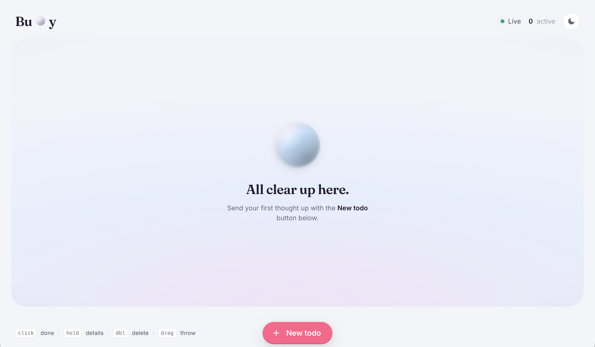
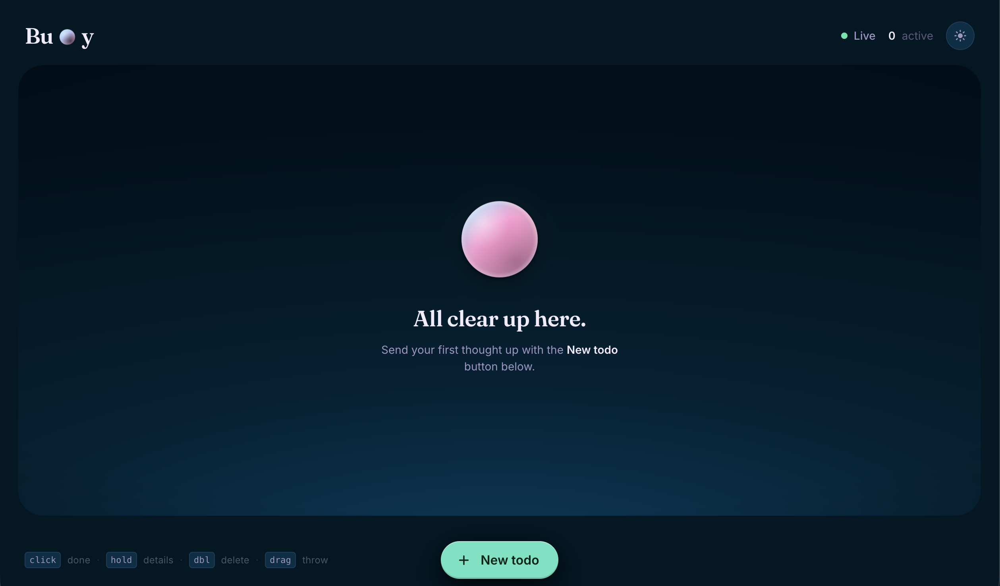
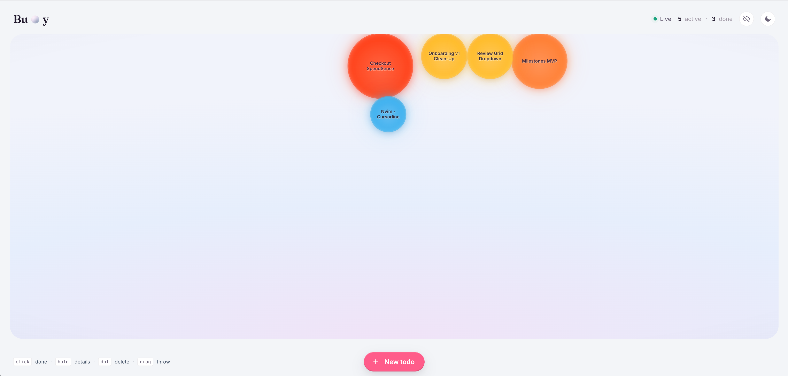

# 🫧 Buoy

A floating-bubble to-do app.

Each task is a bubble. Bigger bubbles (higher priority) rise to the top of the canvas and bob around. Click to complete (the bubble _pops_), right-click or long-press to see details, drag to throw it across the screen. The active tasks live in a human-editable `data/todos.md` file — edit it on your host in any text editor and the running app picks up the change over WebSocket after the file settles.

|                   Daydream (light)                   |                   Nightswim (dark)                   |
| :--------------------------------------------------: | :--------------------------------------------------: |
|  |  |

## Run Buoy Locally

### Dev (hot reload on both sides) - _QUICKEST_

Install and start Docker, then run:

```bash
./bin/dev
```

Visit **<http://localhost:5173>**. Frontend changes hot-reload via Vite; backend changes restart Node. The API runs on port 3005, so dev and production can run side by side.

Dev uses a separate, initially empty `.dev-data/` directory; changes there do not affect your production tasks in `data/`. Edits to `.dev-data/todos.md` also sync to the UI via WebSocket.

- `./bin/dev`: start the dev stack in the foreground. Press Ctrl+C to stop it.
- `./bin/rebuild-dev`: rebuild images and refresh dependencies, then start. Use after changing dependencies.
- `./bin/stop-dev`: stop and remove the dev containers and network, without deleting dev data.

### Without Docker (two terminals) - _Why would you prefer this?_

```bash
# Terminal 1
cd backend && npm install && npm run dev      # → http://localhost:3004

# Terminal 2
cd frontend && npm install && npm run dev     # → http://localhost:5173
```

Unlike Docker dev, this uses the live `data/` directory and port 3004 by default; do not run it alongside production against the same data.

### Production (one container, one port) - _IDEAL_ :)

Install and start Docker first. From the repo root, build and run Buoy:

```bash
./bin/build-prod
```

Visit **<http://localhost:3004>**. Port 3004 must be available. The container runs in the foreground; press Ctrl+C to stop it. Your tasks persist in the host's `data/` directory, which is mounted into the container.

**Scripts** (run from the repo root):
- `./bin/build-prod`: builds a fresh `buoy:prod` image without Docker's build cache, then starts it. Use after code changes when no production container is running.
- `./bin/run-prod`: starts the existing `buoy:prod` image without rebuilding. Run `build-prod` first if the image doesn't exist.
- `./bin/rebuild-prod`: stops containers publishing host port 3004 with this repo's `data/` mounted at `/app/data`, regardless of image, then builds and starts a fresh image. Use to replace a running production container after code changes.

**Optional: shorter commands with direnv.** Install [direnv](https://direnv.net/docs/installation.html) and [hook it into your shell](https://direnv.net/docs/hook.html). Then, from the repo root, run `direnv allow` once to approve the project's `.envrc`. It adds `bin/` to your `PATH` while you're in the directory, so you can use `dev`, `rebuild-dev`, `stop-dev`, `build-prod`, `run-prod`, and `rebuild-prod` without the `./bin/` prefix. Direnv is not needed if you use the paths above.

The bundle is built with empty `VITE_API_URL`/`VITE_WS_URL` so it uses same-origin relative paths — works behind any reverse proxy, on any host, http or https.

## Stack at a glance

Physics: Because your to-dos need some bubbly motivation!

| Layer    | Tech                                                                                   |
| -------- | -------------------------------------------------------------------------------------- |
| Frontend | React 18 · Vite · matter.js (physics) · framer-motion                                  |
| Backend  | Node 20 · Express · `ws` (WebSockets) · `chokidar` (file watcher)                      |
| Storage  | a plain `todos.md` file (no real DB)                                                   |
| Dev      | `docker-compose.yml` with two containers + bind mounts                                 |
| Prod     | single multi-stage `Dockerfile` — Express serves both API and built bundle on one port |

## The data file

`data/todos.md` is plain markdown. A database as basic as a text file. Because it is.

Archived tasks and sections are stored in `data/archive.md` — the peaceful farm where completed tasks go to play in the open fields. Metadata rides in an HTML comment so it's invisible when rendered:

```markdown
# Buoy Todos

- [ ] `nvim` - Install harpoon <!-- id:a1b2c3 priority:2 created:2026-05-21T10:00:00Z description:"From the corner store" -->
- [x] Ship the bubble app <!-- id:d4e5f6 priority:0 created:2026-05-20T09:00:00Z completed:2026-05-20T18:00:00Z -->
```

You can hand-type `- [ ] something new` with no metadata — the parser tolerates the absence, and the next write fills in defaults (new id, priority 2, timestamps). Priorities run 0–4, with **P0 being the most urgent** (biggest, hottest bubble). P0 is the loudest crybaby. P4 is the least attention-seeking older child.

## Interactions

The UI shows all keybindings and is self-explanatory. Read the README if you're bored.

|                     Daydream (light)                     |                     Nightswim (dark)                     |
| :------------------------------------------------------: | :------------------------------------------------------: |
|   |     |

| Gesture                      | Action                             |
| ---------------------------- | ---------------------------------- |
| **Click** a bubble           | Toggle done (pop animation)        |
| **Right-click / long-press** | Open the detail overlay            |
| **Detail overlay**           | Edit or delete a todo              |
| **Drag**                     | Throw — physics resumes on release |
| **+** floating button        | Open the add-todo modal            |
